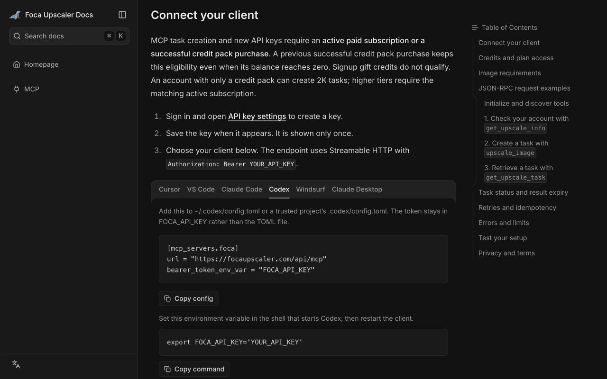
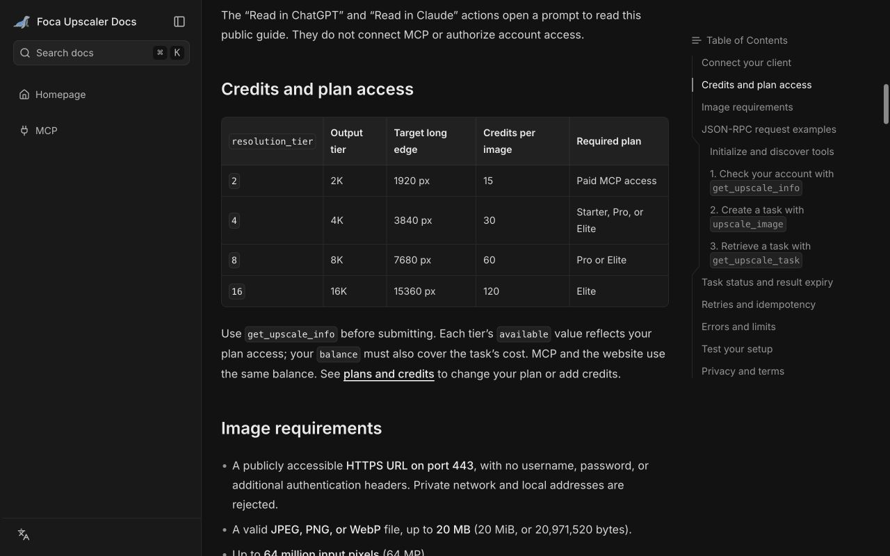
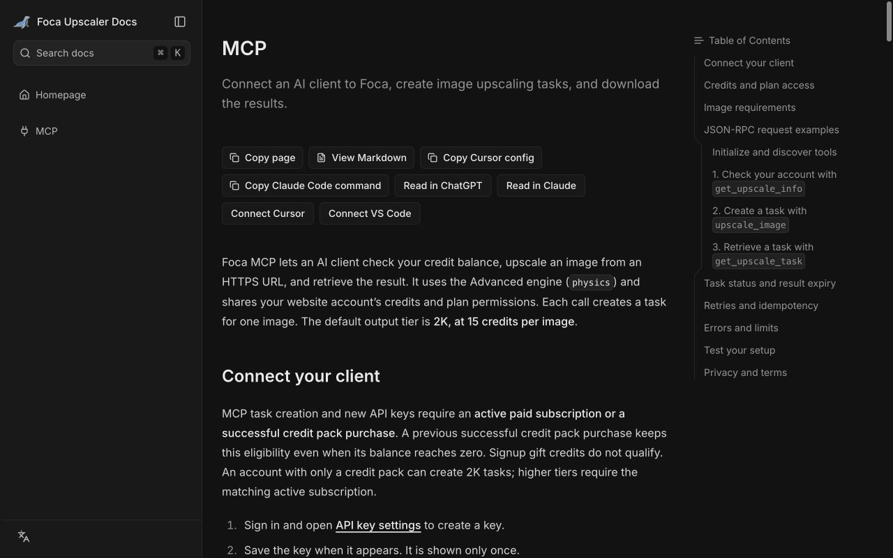

# Foca Upscaler MCP

Upscale images from your AI assistant with [Foca Upscaler](https://focaupscaler.com), a hosted MCP service. Check account credits, submit an image, and retrieve the completed result through three tools.

| Before | After Foca upscaling |
| --- | --- |
|  |  |

Example from Foca's public website gallery. Results vary by image.

| | |
| --- | --- |
| Live endpoint | `https://focaupscaler.com/api/mcp` |
| Transport | Streamable HTTP |
| Authentication | Bearer API key |
| Documentation | [Foca MCP guide](https://focaupscaler.com/docs/mcp) |
| API keys | [Create or revoke a key](https://focaupscaler.com/settings/api-keys) |
| Support | [support@focaupscaler.com](mailto:support@focaupscaler.com) |

## Connect your client

Sign in to Foca and [create an API key](https://focaupscaler.com/settings/api-keys). Task creation requires an active paid subscription or a previously successful credit-pack purchase. The key is shown only once. Replace `YOUR_API_KEY` locally and keep the configured key private; never put it in a prompt, URL, or public repository.

Choose one of the six configurations below. Foca runs the server for you. Claude Desktop uses a local bridge and requires Node.js with `npx`.

### Cursor Marketplace plugin

This repository includes a Cursor plugin manifest at `.cursor-plugin/plugin.json` and a remote MCP configuration in `mcp.json`. Once the plugin is available in your marketplace, install **foca-upscaler** from Customize → Plugins, then configure `FOCA_API_KEY` with a key from [API key settings](https://focaupscaler.com/settings/api-keys). Never commit a configured key. Marketplace publication is subject to review.

For local testing, copy the plugin files into `~/.cursor/plugins/local/foca-upscaler`, reload Cursor, and confirm the Foca MCP server appears in Customize. Configure your own key through the client configuration UI. The plugin contains configuration only; Foca hosts the processing service.

Start with this read-only prompt: “Call Foca get_upscale_info and show my balance and available tiers. Do not create a task.” Queries do not charge task credits. A new default 2K task costs 15 credits and requires paid access. See the [MCP guide](https://focaupscaler.com/docs/mcp) for details.

### Cursor manual configuration

Add this server to your MCP settings (`.cursor/mcp.json`):

```json
{
  "mcpServers": {
    "foca": {
      "url": "https://focaupscaler.com/api/mcp",
      "headers": {
        "Authorization": "Bearer YOUR_API_KEY"
      }
    }
  }
}
```

### VS Code

Add to `.vscode/mcp.json`. VS Code prompts for the key as a password input:

```json
{
  "inputs": [
    {
      "type": "promptString",
      "id": "foca-api-key",
      "description": "Foca API key",
      "password": true
    }
  ],
  "servers": {
    "foca": {
      "type": "http",
      "url": "https://focaupscaler.com/api/mcp",
      "headers": {
        "Authorization": "Bearer ${input:foca-api-key}"
      }
    }
  }
}
```

### Claude Code

Run this command after replacing the placeholder:

```bash
claude mcp add --transport http foca https://focaupscaler.com/api/mcp \
  --header 'Authorization: Bearer YOUR_API_KEY'
```

### Codex

Set the environment variable in the environment that launches Codex:

```bash
export FOCA_API_KEY='YOUR_API_KEY'
```

Add to your Codex `config.toml`:

```toml
[mcp_servers.foca]
url = "https://focaupscaler.com/api/mcp"
bearer_token_env_var = "FOCA_API_KEY"
```

### Windsurf

Add to your MCP configuration (`mcp_config.json`):

```json
{
  "mcpServers": {
    "foca": {
      "serverUrl": "https://focaupscaler.com/api/mcp",
      "headers": {
        "Authorization": "Bearer YOUR_API_KEY"
      }
    }
  }
}
```

### Claude Desktop

Add to `claude_desktop_config.json` and restart Claude Desktop. This configuration pins the bridge to `mcp-remote@0.15.1`:

```json
{
  "mcpServers": {
    "foca": {
      "command": "npx",
      "args": [
        "-y",
        "mcp-remote@0.15.1",
        "https://focaupscaler.com/api/mcp",
        "--transport",
        "http-only",
        "--header",
        "Authorization:${FOCA_AUTH_HEADER}"
      ],
      "env": {
        "FOCA_AUTH_HEADER": "Bearer YOUR_API_KEY"
      }
    }
  }
}
```



## Tools and workflow

| Tool | Input | Purpose |
| --- | --- | --- |
| `get_upscale_info` | `{}` | Check `balance`, `can_create_tasks`, tier availability, prices, and limits. |
| `upscale_image` | `image_url`, `idempotency_key`, optional `resolution_tier` | Create one paid upscaling task using the `physics` engine. |
| `get_upscale_task` | `task_id` | Retrieve a task and its completed download link. |

1. Call `get_upscale_info`. Check `can_create_tasks`, the selected tier's `available` value, and sufficient `balance`.
2. Confirm the image, output tier, and credit cost with the user, then call `upscale_image`.
3. Call `get_upscale_task` with the returned `task_id` every **5 seconds** until `succeeded` or `failed`. Back off if rate limited and stop at a terminal status.
4. On success, download from `download_url` before `expires_at` and save your copy.

Task states are `pending`, `processing`, `succeeded`, and `failed`. Both task tools report the current account balance in top-level `credits_remaining`.

## Credits and image limits

MCP and the website share the same account credit balance. An active paid subscription or a previously successful credit-pack purchase establishes MCP task eligibility; promotional credits alone do not. Your plan also controls the available output tiers.

| `resolution_tier` | Output tier | Target long edge | Credits per image | Required access |
| --- | --- | --- | --- | --- |
| `2` | 2K (default) | 1920 px | 15 | Paid MCP access |
| `4` | 4K | 3840 px | 30 | Starter, Pro, or Elite |
| `8` | 8K | 7680 px | 60 | Pro or Elite |
| `16` | 16K | 15360 px | 120 | Elite |

Inputs must be publicly retrievable **HTTPS URLs on port 443**, with no additional request credentials. Supported images are **JPEG, PNG, and WebP**, up to **20 MiB (20,971,520 bytes)** and **64 million pixels (64 MP)**. Private network and local addresses are rejected. Check `get_upscale_info` for current limits and access before submitting.



Example `upscale_image` arguments (replace the illustrative image URL):

```json
{
  "image_url": "https://images.example.com/source.png",
  "resolution_tier": 2,
  "idempotency_key": "foca-example-request-001"
}
```

Use an image you own or have permission to process. For a retry, preserve the exact `idempotency_key`, `image_url`, and `resolution_tier`; a replay returns the original task without another task charge. Keys contain 1–128 characters and are scoped to the account. Use a new key for a different image or tier. Idempotency records are retained for **at least 30 days**, then removed by daily cleanup. After removal, reusing an old key can create a new task and charge credits again.

Results are retained for **24 hours from task creation**. Download links expire separately; follow `expires_at` and request the same task again for a fresh link while its result remains retained. After retention ends, lookup returns `RESULT_EXPIRED` or `TASK_NOT_FOUND`. Save the result within 24 hours.

## More information



- [Agent-readable connection guide](llms-install.md)
- [Product information and FAQ](listing.md)
- [Server metadata](server.json) and [tool metadata](server-card.json)
- [Plans and credits](https://focaupscaler.com/pricing)

## License

The [MIT license](LICENSE) covers the documentation, metadata, and assets in this repository. Foca is a hosted service; this repository does not distribute or license its backend implementation. Service access is governed by Foca's account terms, plan permissions, and credits.
